## 当前交付：Phase 7 v0.7.0（2026-10-13）

普通主世界中的完整地下景观：两次梦境获得回响，循微光定位到山间入口，乘特殊中立幻翼牵引的封闭车厢下降，游览已认可的六栋小镇与铁桥，再安全返回。整个景观局部禁怪，主世界其他区域正常刷怪；沿用Phase 6建筑与冷蓝基准，仅自然化外围岩体。

[JAR](artifacts/glimmering-abyss-0.7.0.jar) · [安装与游玩](INSTALL-PHASE7.md) · [完整测试报告](TEST-REPORT-PHASE7.md) · [恢复](HANDOFF.md) · [阶段原图](https://msipla.github.io/-Moonlit-Halt/phase7.html)

正式实跑38354855268全部通过：两个种子生成、局部安全与外部自然刷怪、真实睡眠、三段阶梯进出、21段地下行走、正常乘车往返、潜行提前返回及途中停服后的健康安全重连。16张原始PNG与失败历史保留。托管Linux客户端／服务端已测，Windows/PCL2及第三方渲染未测；新增画面待用户审阅。PR #1已合并main，既有Pages已发布并通过实际线上Chromium检查；记录见HANDOFF及网站测试报告。

以下保留Phase 6及更早阶段当时的记录；Phase 6整体美学后续已获认可。

---

## 历史交付：Phase 6 v0.6.0（2026-10-13）

六栋维多利亚风格建筑、短主街与小广场、有限陆架断崖、可登观景塔和原铁桥。整个实验景观维度排除普通怪物及其他生物；困难难度和主世界对照实测通过。保持原工坊、冷蓝、52个原暖窗与巨柱；95%与深处渐变供同机位对照，用户美学验收待定。

[第六阶段原图](https://msipla.github.io/-Moonlit-Halt/phase6.html) · [安装](INSTALL-PHASE6.md) · [测试报告](TEST-REPORT-PHASE6.md) · [恢复](HANDOFF.md) · [JAR](artifacts/glimmering-abyss-0.6.0.jar)

正式客户端/服务端实跑38274690365：9项测试、2,038,574处结构状态、16段行走与登梯、防坠栏、复放/重启、128暖窗12级光、26原始PNG通过。托管Linux软件OpenGL已测；目标Windows/PCL2与第三方渲染未测。主世界生成、梦境和缆车未开发。

以下为保留的历史阶段记录。

# Phase 5 · 铁桥与垂直深渊 v0.5.0

保留已认可的一栋工坊与冷蓝/暖窗关系，适度精修砖饰、入口山墙与铁艺。新增一座可通行铁桥、一处有限局部竖井与小观景台；实际可从工坊走到目的地再返回，保持空旷留白。

[第五阶段原图与交付](https://msipla.github.io/-Moonlit-Halt/phase5.html) · [安装说明](INSTALL-PHASE5.md) · [实测报告](TEST-REPORT-PHASE5.md) · [最新交接](HANDOFF.md)

`/abyss enter` → `/abyssrender blue` → `/abyss route` → `/abyss route view interior`。本阶段原图与精修等待用户审阅；技术通过不代表美学通过。Windows/PCL2 与目标 GPU 尚未实测。

**本阶段唯一任务书：[TASK-PHASE5.md](TASK-PHASE5.md)。** 不扩大城市，不开发梦境、幻翼缆车或正式主世界生成，也不混入月下小站开发。下方为历史阶段说明，当前实际结果以 HANDOFF 和第五阶段报告为准。

---

> 第四阶段恢复：第三阶段工程交付已完成，用户认可冷蓝环境与局部暖光方向。当前建筑版本与实测结果见下列新入口；后文保留第三阶段历史说明。

# Phase 4 · 地下工坊原型 v0.4.0

一栋独立维多利亚／哥特工业风砖石工坊，坡屋顶、拱窗、烟囱、小塔楼、克制暖窗及连接步道；保留原有洞厅和空间光，不在主世界自然生成，不加入可见居民。

[第四阶段原图](https://msipla.github.io/-Moonlit-Halt/phase4.html) · [安装与复测](INSTALL-PHASE4.md) · [第四阶段测试报告](TEST-REPORT-PHASE4.md) · [最新交接](HANDOFF.md)

`/abyss enter` → `/abyssrender blue` → `/abyss building` → `/abyss building view facade`。完整技术/美学状态以 Phase 4 报告为准。技术验证与用户美学验收分开记录，Windows/PCL2、目标 GPU 与第三方渲染模组尚未实测。

---

> 2026-10-12：v0.3.0 环境视觉原型已实际运行；用户美学验收待定。第二阶段美学不通过，原始证据与旧安装包保留。

# Project 02 · 微光深渊（Glimmering Abyss）

Minecraft Java **1.20.1** 的独立地形／光照技术原型，版本 **0.3.0**。第三阶段增加世界位置与表面朝向决定的环境辐照、受控空气透视与冷蓝/铜金配置；保留既有地形、原生光传播及 A/B/C/Veil。

[第三阶段原图对照](https://msipla.github.io/-Moonlit-Halt/phase3.html) · [第三阶段报告](TEST-REPORT-PHASE3.md) · [工程恢复入口](HANDOFF.md)

[打开 Phase 2 真实截图对照](https://msipla.github.io/-Moonlit-Halt/phase2.html) · [第二阶段测试报告](TEST-REPORT-PHASE2.md) · [第二阶段开发日志](devlog/2026-10-12-phase2.md)

第一阶段原始说明 [BRIEF.md](BRIEF.md)、[测试报告](TEST-REPORT.md)、[开发日志](devlog/2026-10-12-phase1.md)、[证据](evidence/phase1/) 与 0.1.0 JAR 均保留。正式美学依据来自仓库 `research/aesthetics/` 的 2026-10-12 基准与聊天摘录。技术 PASS 与用户美学验收分开记录；当前第二阶段美学明确不通过。

## 已实现

- 注册独立测试维度 `glimmeringabyss:study` 与自定义 `ChunkGenerator`。地形直接在 Minecraft 区块生成阶段产生，没有使用 WorldEdit、手工摆块或预建地图冒充生成。
- 固定研究种子 `74102002`；约 208 × 248 格的洞厅、七根岩柱、起伏底部与两段断崖；岩体边缘会随种子变化。
- 一段平整短通道与宽观景台，前方、两侧及后方入口两边具有两格高铁栏；三个原始落地观察位置，另加一个创造模式飞行俯视点。
- 26 个测试光源，包括洞厅岩面、近景和一个独立封闭校准通道内的光源。支持 **0／5／15** 光级对照，三种模式保持光源位置、方块形状与纹理一致。
- 保留原版 Minecraft 光照传播与材质。A 不改环境显示；B/C 仅在测试维度修改 lightmap 底光与原版距离混合参数，局部光斑不改变光级。没有彩色光传播、第三方光影、泛光或屏幕后期。
- 测量工具读取真实 `ServerWorld` 的天空光、方块光、路线方块和地形指纹。可用两个全新世界核对重复生成。
- 可选客户端检查取得真实游戏帧缓冲截图、帧间隔，并让实际玩家沿通道前进测试护栏碰撞。v0.2 自动采集 12 张 A/B/C 同机位图、5 张机制对照和 2 张静止稳定性帧。

这是一处预设的程序化实验洞厅；尚未将生成器注入主世界自然洞穴，也未制作完整地下生态、城市、NPC 或玩法系统。

## 安装体验

1. 使用 **Minecraft Java 1.20.1 + Fabric Loader 0.14.25 + Java 17** 的独立测试实例。
2. 把 [glimmering-abyss-0.3.0.jar](artifacts/glimmering-abyss-0.3.0.jar) 与 [Fabric API 0.85.0+1.20.1](https://maven.fabricmc.net/net/fabricmc/fabric-api/fabric-api/0.85.0+1.20.1/fabric-api-0.85.0+1.20.1.jar) 放进该实例的 `mods` 文件夹。
3. 新建测试世界，建议创造模式并允许作弊，聊天栏输入：

```mcfunction
/abyss enter
/abyss light glimmer
/abyss view platform
/abyssrender blue
```

同一实例只放一个 Glimmering Abyss 版本；不要同时加载多个 0.1.0 / 0.2.0 / 0.3.0 版本。

按 Minecraft 原有 WASD、鼠标与跳跃操作漫游。观景台护栏会挡住正常行走的玩家；创造模式飞行仍可越过护栏。

| 命令 | 用途 |
| --- | --- |
| `/abyss enter` | 进入通道观察点 |
| `/abyss view tunnel` | 通道机位 |
| `/abyss view platform` | 观景台中央机位 |
| `/abyss view edge` | 深渊边缘机位，仍位于护栏内 |
| `/abyss view overlook` | 创造模式固定飞行俯视机位；其他机位恢复落地 |
| `/abyssrender blue` / `copper` | 可配置空间光预设 |
| `/abyssrender reload` | 重读实例 config/glimmeringabyss-visuals.json |
| `/abyss lamps on` / `off` | 临时原版灯笼校准；可恢复移除 |
| `/abyssrender a` | 原版环境渲染基线 |
| `/abyssrender b` | 自然空间层次 |
| `/abyssrender c` | 历史第二阶段远景方案；美学不通过 |
| `/abyssrender veil` | 明显雾幕诊断方案，不作为推荐体验 |
| `/abyss light baseline` | 所有测试光源为 0 级 |
| `/abyss light glimmer` | 所有测试光源为 5 级 |
| `/abyss light reference` | 所有测试光源为 15 级 |
| `/abyss audit` | 写出实际光照、路线与地形测量 JSON |
| `/abyss return` | 返回主世界出生点附近 |

进入世界默认 A；B/C 的显示过渡约 0.8 秒，回 A 直接恢复原版。设置仅对实验维度生效，不影响主世界。

切换光照后等待至少五秒再测量。光照和审计命令需要作弊／管理员权限。重新载入测试存档后，先执行一次光照切换，再做审计；审计的预期模式取自最近一次指令。

## 固定条件

| 参数 | 值 |
| --- | --- |
| Minecraft／Java | 1.20.1／17 |
| Fabric Loader／API | 0.14.25／0.85.0+1.20.1 |
| 研究种子 | 74102002，写入维度生成器 JSON |
| 自动测试主世界种子 | 74102002 |
| 测试维度高度 | Y = -64 至 127 |
| 世界天空光／环境亮度 | 无天空光，`ambient_light = 0.0`；B/C 的底光是客户端显示机制 |
| 时间／生物 | 固定夜间；本测试生物群系没有生物生成条目 |
| 截图 | 1280 × 720，FOV 75，亮度设置 0.5 |
| v0.2 截图视距／模拟距离 | 16／6 区块；第一阶段为 12／6 |

研究种子与普通世界创建时填写的种子分别记录。本维度的研究种子固定，因此另建主世界仍可复现同一实验洞厅。更改生成参数时使用新测试世界，避免旧区块掩盖生成器改动。

## 构建

需要 **JDK 17**；Gradle 8.2.1 Wrapper 已包含，发行包 SHA-256 已固定，无需全局安装 Gradle。

Windows PowerShell：

```powershell
.\gradlew.bat build
```

Linux／macOS：

```sh
./gradlew build
```

可安装的正式 JAR 输出为 `build/libs/glimmering-abyss-0.3.0.jar`。`sources.jar` 用于查阅源码，不放进 `mods` 文件夹。

## 复现游戏检查

需要 Python 3、JDK 17 和联网下载官方依赖。测试软件和全新存档都放在本项目忽略的 `.runtime/` 中，服务端只监听 `127.0.0.1:25585`。

```sh
python tools/run_experiment.py --accept-eula --output evidence/local-run
```

以上执行正式 JAR 服务端、三种原版光照测量以及第二个全新世界的地形指纹比较。`--accept-eula` 表示接受这个独立测试服务端的 Minecraft EULA，链接为 <https://aka.ms/MinecraftEULA>。

在可用桌面／X 显示环境中运行第二阶段真实 Minecraft 开发客户端对照（不是渲染替身）：

```sh
python tools/run_experiment.py --accept-eula --capture --phase2 --output evidence/local-phase2-run
```

不带 `--phase2` 的 `--capture` 保留第一阶段九张原生 0／5／15 光级采集路线。`--phase2` 的服务端与客户端统一使用 16 区块，主比较全部为原生 5 级光源。

已成功构建后可加 `--skip-build` 复用同一正式 JAR。单独开发客户端可用 `./gradlew runClient` 启动，再创建测试世界输入上述命令。

已有成功安装的官方 Fabric 服务端引导目录时，可加 `--server-template 路径` 复用依赖下载；脚本仍建立新的测试 MOD 目录、世界与启动缓存，保留模板原目录。此路径也用于本次云端下载暂时失败后的完整重复验证。

云端本次对 Unix 套接字及显示环境有额外限制。可选的 [cloud_loom_compat.py](tools/cloud_loom_compat.py) 只适配明确指定的私有构建缓存，不属于 MOD。具体环境适配、失败记录与测量边界见测试报告；普通桌面不需要照抄云端库路径或代理参数。

## v0.2 原始游戏截图

完整四机位、原图查看、滑动对照、参数和性能见 [Phase 2 报告页](https://msipla.github.io/-Moonlit-Halt/phase2.html)。原始数据在 [evidence/phase2/](evidence/phase2/)，保留的中间失败方案在 `evidence/phase2/attempts/`。截图未经提亮或调色。

| 观景台 A | 观景台 B | 观景台 C |
| --- | --- | --- |
| 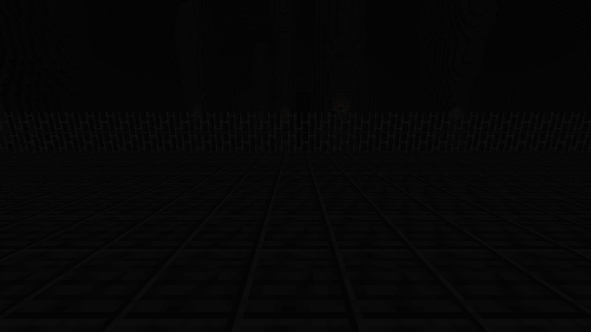 | 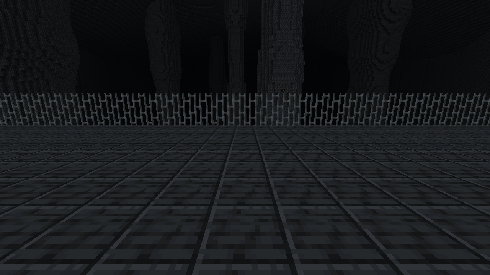 | 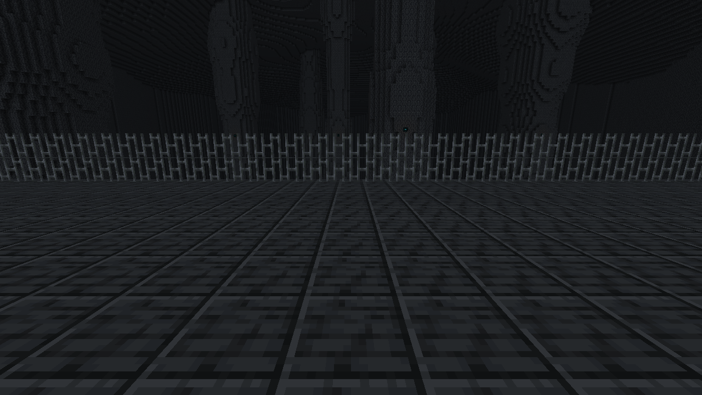 |

## 第一阶段原始游戏截图

每列为同一个机位、同一画质设置的真实 Minecraft 客户端截图，没有提亮或调色。黑暗本身也是实验结果。点击图片看原尺寸。

| 机位 | 0 级基线 | 5 级微光 | 15 级对照 |
| --- | --- | --- | --- |
| 通道 | 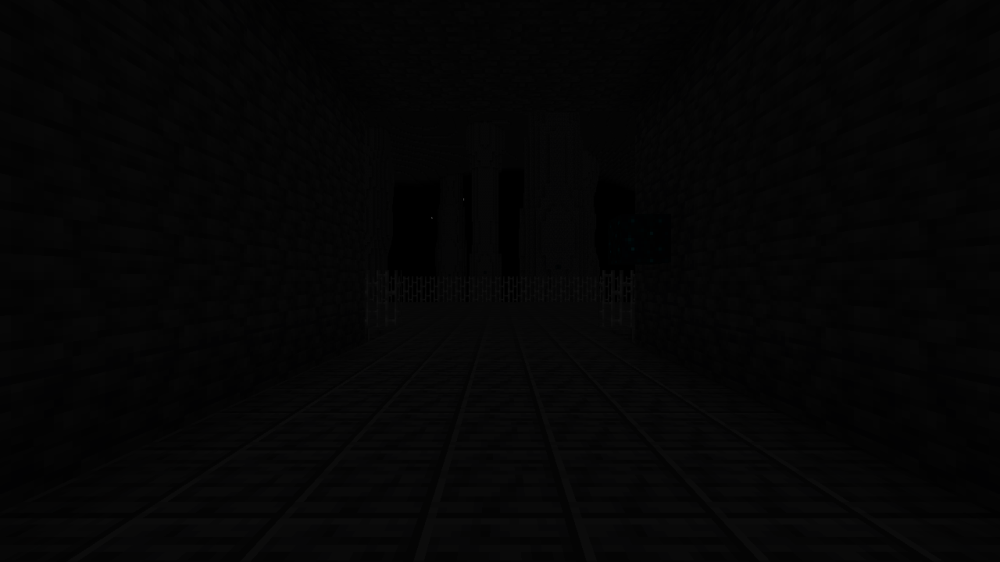 | 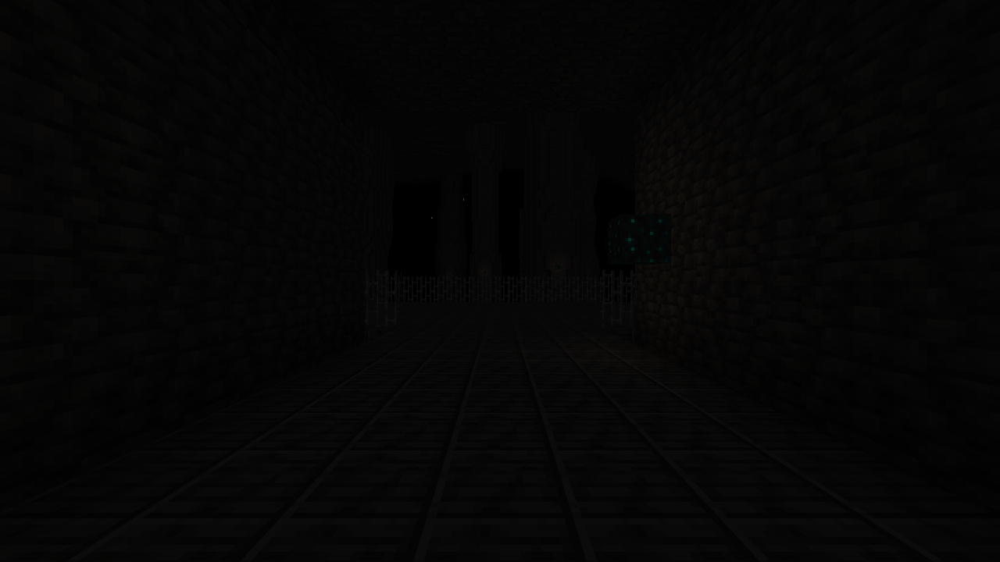 | 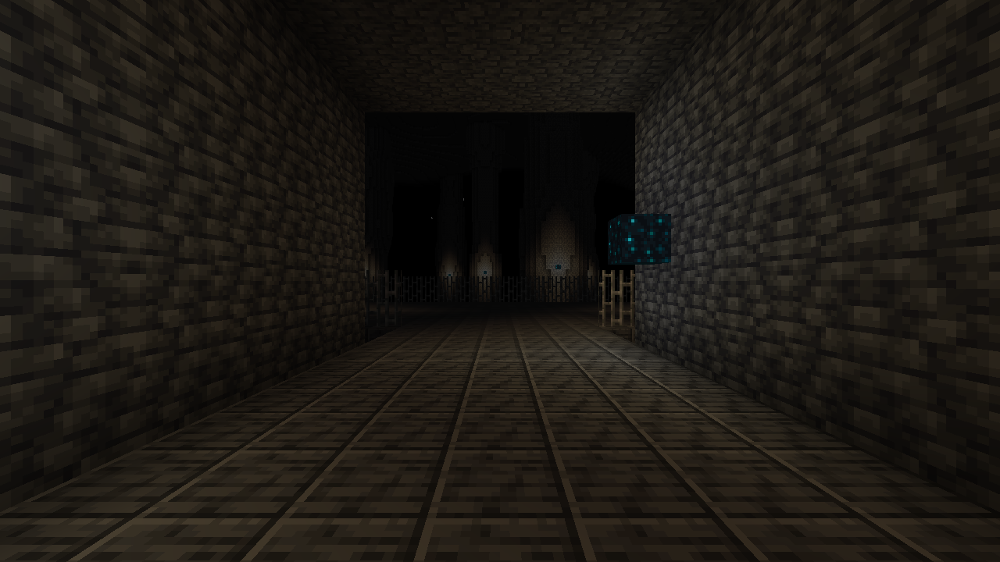 |
| 观景台 | 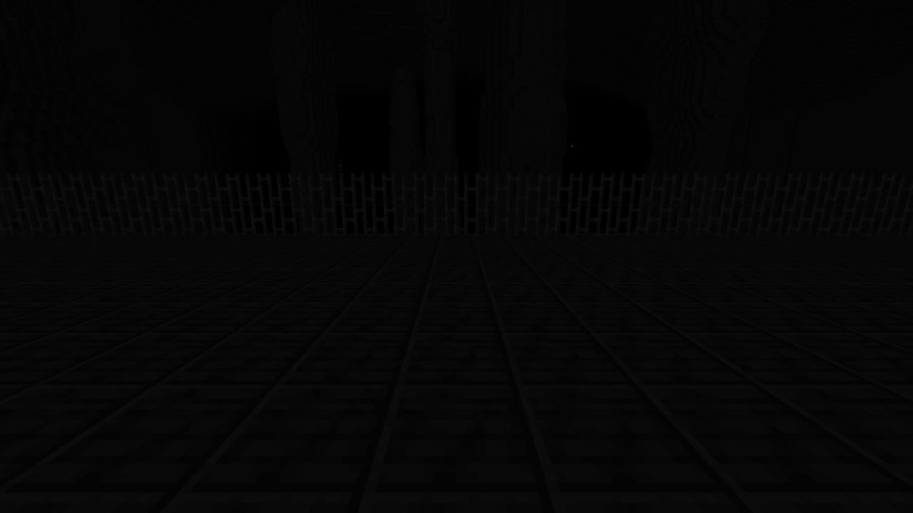 | 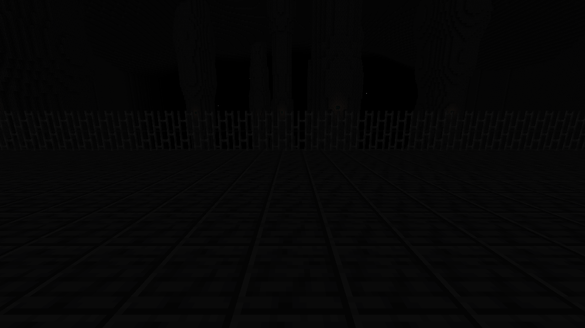 | 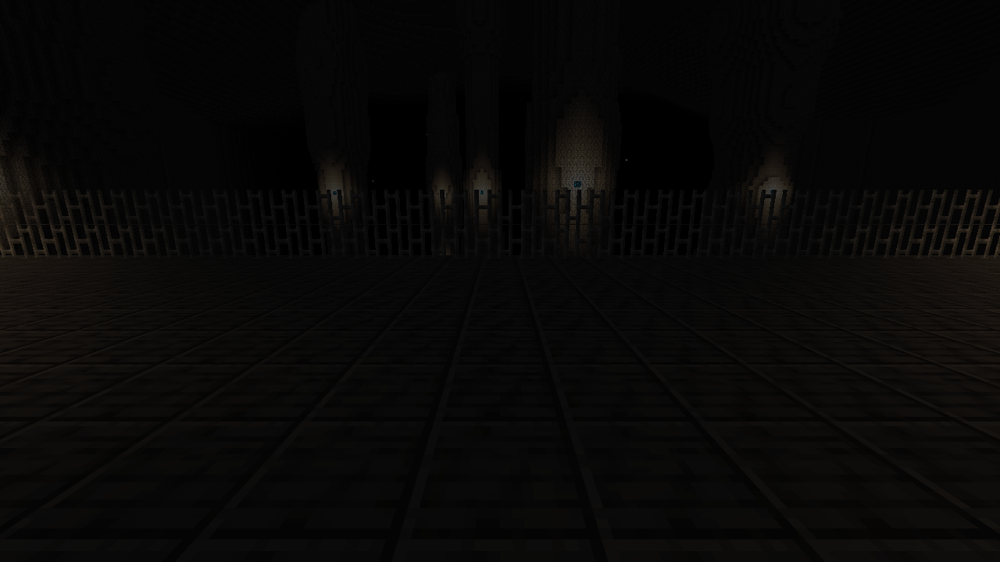 |
| 边缘 | 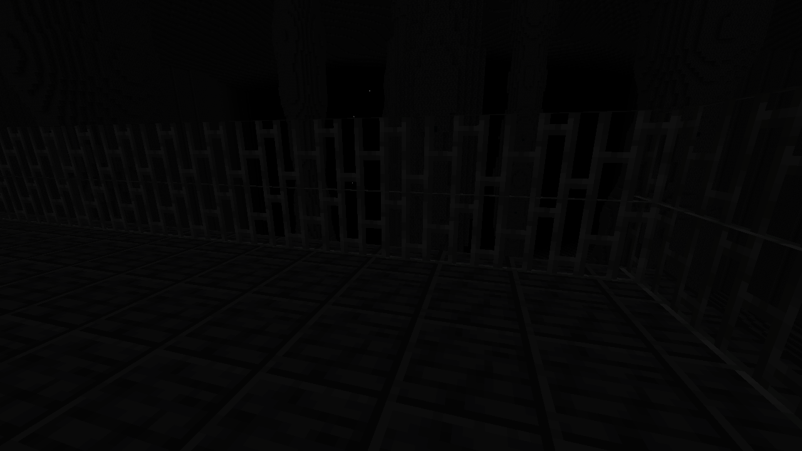 | 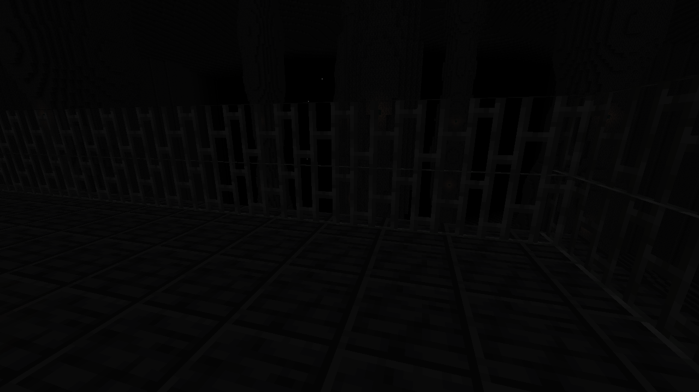 | 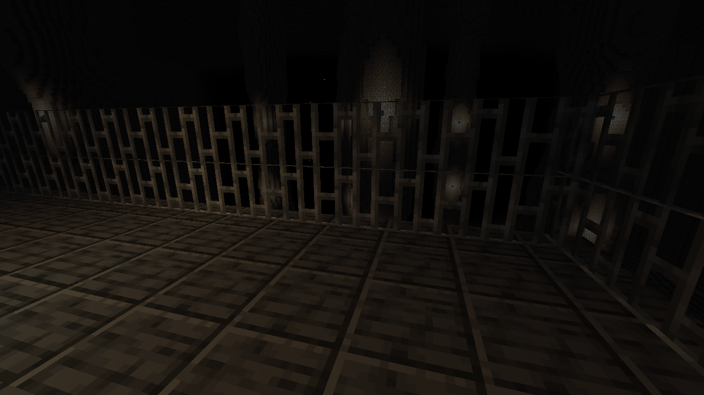 |

## 文件与依赖入口

- `src/main/`：地形、维度、光照命令、实际测量与可选客户端检查。
- `src/test/`：地形和路线测试，以及基线恒等、强光保留、远景衰减不变量。
- `artifacts/`：本实验正式 JAR、源码 JAR 和校验信息。
- `evidence/phase1/`：原始截图、机位／帧时间、实际光照 JSON、运行日志与总体结果。
- `evidence/phase2/`：A/B/C 原图、底光与作用域控制、性能、全新世界审计、构建结果、失败记录。
- `evidence/diagnostics/`：保留的失败检查记录。

官方版本资料：[Minecraft 1.20.1](https://www.minecraft.net/en-us/article/minecraft--java-edition-1-20-1)、[Fabric 安装器](https://fabricmc.net/use/installer/)、[Fabric API 发布仓库](https://github.com/FabricMC/fabric-api)、[Fabric Maven](https://maven.fabricmc.net/)。

## 第三阶段证据与待办

最新运行入口 `evidence/phase3/latest.json`；两轮各自保存，正式候选包来源见 `artifacts/checksums-v0.3.json`。本轮 21 张原图和 9 项测试通过。第三阶段蓝/铜金 shader 不更改 lightmap；上文 B/C 是历史第二阶段显示路线。新系统目前只处理实验维度的不透明/cutout 地形，未做几何遮挡与透明材质适配。完整范围、实测/未测分级和待办见 [TEST-REPORT-PHASE3](TEST-REPORT-PHASE3.md)。

下一步先由用户验收原图，再按反馈推进；Windows/PCL2/GPU 与第三方渲染兼容测试仍待执行。
