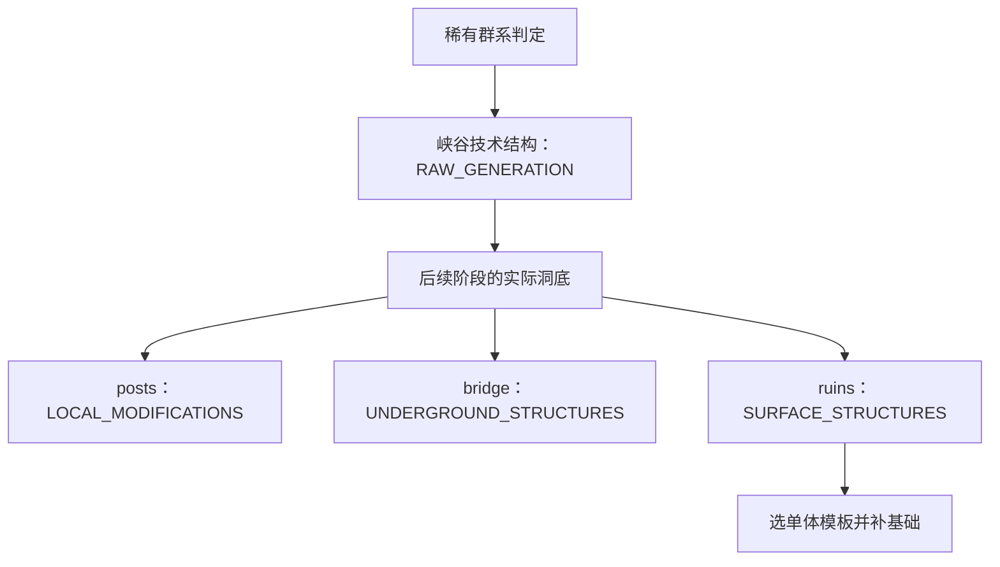

# 《微光深渊》Alex's Caves 异寂空谷世界生成源码研究

研究日期：2026-10-16（Asia/Shanghai）。状态：源码研究完成；建议均为待授权设计，不代表批准实施。

## 1. 结论先行

1. **源码证实：异寂空谷的大空间主要由技术结构雕刻。** `ForlornCanyonStructure` 在 `RAW_GENERATION` 阶段把区域拆成小块，按带 Y 变化的噪声判定清除岩体；原版洞穴 Carver、表面规则、桥梁和小屋 Feature 分工叠加。[U1][U2][U3][U5][U12]
2. **源码证实：小屋先找已有洞底，再放单体模板，最后补基础。** 落点从实际世界的一列“不可替换块→可替换块”转折中选取，且必须是泥坯（`packed_mud`）；随后随机旋转／选模板、整体放置，再向下填补支撑。这是“先有地貌，再安置单体，局部改造基础”的组合。[U6][U7]
3. **证据边界：没有找到名为 `Underzealot Borough` 的独立城镇生成器。** 固定提交中没有同名类、注册 ID、配置或结构池；已证实的相关路径是 `forlorn_ruins`／`forlorn_posts` 小型散布模板与独立 `forlorn_bridge`。不能把外部对聚落的称呼扩写成“已有完整的街道、桥梁、房屋网络规划器”。名称与这组机制的一一对应仍未知。
4. **对本工程的价值在生成思想，不在整体移植。** 最新 preview.4 已有有限多尺度岩壁、稀疏建筑蓝图、缩减占地和旧档布局保护，不能按旧截图重复开发。最值得做的是小范围验证“建筑落点是否真正服从同一套岩体”，并检查跨块与重启稳定性；不建议更换世界生成架构或照搬上游台阶公式。[M1][M2][M3][M4][M5]

## 2. 研究基线、权限与方法

| 项目 | 固定研究基线与证据 |
| --- | --- |
| 协作规范 | 已读取 Conversation-Archives 最新 `AGENTS.md`，blob `12382d57b6cddbcd71fdd4ec39e2236f247f0add`；工程 main 的 `AGENTS.md`，blob `eed7e621780fde4cd6bca25b240bf550d0ad4006`；同时核对 V1 工作分支规范 |
| 正式范围 | 工程 main 的 `TASK-FORLORN-HOLLOWS-RESEARCH.md`，blob `87ca31f684bdfb716aaa113976ae79ec27974173`；已读 `TASK-V1.0.md`，尤其第八节 [M0] |
| 工程 main | `f8006467acb0418d0adbf3947962b0afe2827cf1`，提交任务书时的主线；main 的旧 HANDOFF 不代表 V1 当前生成器 |
| 当前工程对照 | `codex/v1-abyss-world`，HEAD `c3283ac785507e83c42fe404fffaae247482cf61`；PR #6 为 open、draft、未合并。对照其 HANDOFF、源码、模板作者脚本及实际测试 JSON [M4][M6][M7] |
| 已验证产物来源 | preview.4 的源码提交 `6d0fdbc40397c5550e98bd98d69b1ebf0c966692`，运行 `38580056771`；该提交至上述分支 HEAD 的 `src/`、`tools/` 无差异 [M7] |
| 上游 | `AlexModGuy/AlexsCaves`，默认分支 main，HEAD `4718f4287c65b810aecb211789b45f54d405a94d`；提交时间 2025-12-21（-08:00）。该源码自报版本 2.0.2，Minecraft 1.20.1、Java 17、Forge 47.4.1；不把 main 等同已实测发行包 [U16] |
| 本工程环境 | Minecraft 1.20.1、Yarn `1.20.1+build.10`、Fabric Loader 0.14.25／API `0.85.0+1.20.1`、preview.4 [M8] |

**方法与范围：** 固定提交后逐文件审读目标调用链和 JSON；解压、解析全部 12 份 `forlorn_*.nbt` 的 size、palette、blocks、entities、DATA 标记；对照工程生成源码及两种子、重启、旧档升级证据。源码结论不以 Wiki、视频或视觉印象替代。本次没有启动上游游戏、重新构建 MOD、进行新世界性能测试或安卓实测；既有测试结果注明来自既有证据。

**许可证核对：** 上游完整 Git 树中未找到独立 LICENSE／COPYING 文件；`src/main/resources/META-INF/mods.toml:3` 声明 GNU LGPL，但该处未指定版本，作者列为 Alexthe668、Noonyeyz。[U17] `ACSimplexNoise.java:3–18` 另有原作者 public-domain 来源说明，不能据此推断整个 MOD 和 NBT／贴图的授权。[U11] 本报告只分析机制、保留来源链接，没有复制 Java 实现或导入任何上游资产。若后续要直接复用实现／资产，应先明确相应许可版本、范围及署名／分发要求；当前设计建议采用本工程自己的实现。

## 3. 源码索引与生成调用链

下表链接全部固定到上述提交；行号指固定文件中的行，不依赖会移动的 main。

| 索引 | 文件与关键入口 | 作用 |
| --- | --- | --- |
| [U8]、[U9]、[U10] | `mixin/MultiNoiseBiomeSourceMixin.java:29–43`；`ACBiomeRarity.java:42–76`；`BiomeGenerationConfig.java:40–51` | 稀有洞穴生物群系的范围、类型与默认条件 |
| [U1]、[U2] | `ForlornCanyonStructure.java:14–46`；`AbstractCaveGenerationStructure.java:28–113` | 峡谷中心、高宽扫描、分片与生成阶段 |
| [U3]、[U4] | `ForlornCanyonStructurePiece.java:34–102`；基类 `AbstractCaveGenerationStructurePiece.java:32–65,105–116` | 实际体素雕刻、洞底覆泥、边界及持久化 |
| [U5]、[U15] | `ACSurfaceRules.java:14–20,59–65`；`ACSurfaceRuleConditionRegistry.java:20–45` | 岩石材质、洞底泥层与三维材质条件 |
| [U6]、[U7] | `UndergroundRuinsFeature.place():36–91`；`ForlornRuinsFeature.java:21–48` | 实际地形落点、模板旋转、箱子标记、基础补齐 |
| [U13]、[U14] | `ForlornBridgeStructure.java:40–88`；其 Piece `:55–163` | 桥梁独立选址、分节、地形避让与支撑 |
| [U12]、[D1]–[D6] | biome、configured／placed feature、structure／structure_set JSON | 阶段、模板清单与尝试密度 |
| [M1]、[M2]、[M3] | 本工程 `OverworldLandscape`、`OverworldSite`、`AbyssShape` | 主世界有界后处理、布局保护和岩体函数 |
| [M5]、[M9] | `tools/author_abyss_preview.py`；`architecture/settlement_acceptance.json` | 固定建筑落点、稀疏蓝图和已有支撑检查 |

这是生成阶段与数据依赖图，不表示峡谷主动调用桥或房屋，也不表示桥会查找房屋端点。原生噪声地形／表面规则、Carver 先形成基底；技术峡谷在装饰流程早期继续切开岩体。`forlorn_hollows.json` 中仍配置原版 `cave`、`cave_extra_underground`、`canyon`；技术结构不是普通 Carver 的别名。[U12] 阶段名称与顺序对照同版本 Yarn 枚举 [F3]。

## 4. 地貌：什么决定轮廓、高度、岩壁和岩台

### 4.1 群系先限定“在哪里”，技术结构再决定“挖成什么样”

**源码证实：** `ACBiomeRarity` 用带世界 seed 的 Voronoi 区域，叠加固定种子的 X/Z 噪声扰动；区域 hash 决定 rarity offset。Mixin 在 `MultiNoiseBiomeSource.getNoiseBiome` 返回前，用配置条件替换为洞穴群系。[U8][U9] 默认异寂空谷条件为主世界、rarity offset 4、距原点限制参数 650、大陆度 0.6–1、depth 0.3–1.5；配置文件可覆盖默认值。[U10]

depth 是气候采样值，不是“固定 Y 区间”。此外 `BiomeGenerationNoiseCondition.java:134–137` 直接以 X/Z 的平方和检查距离，没有读取实际世界出生点；因此这里是坐标原点周围的默认距离门槛，不能说成距实际出生点650格。[U18] 当前显式 seed／dimension 注入见 `ChunkStatusMixin.java:25–30` [U19]；配置文件中的已弃用 Citadel event 方法不能替代当前 Mixin 调用链。

**源码证实：** `structure_set/forlorn_canyon.json` 使用 `random_spread`，spacing 6、separation 4、salt 6；这些单位是区块候选分布参数，不是每六块挖一洞，也不是每个群系只有一个峡谷。[D5] 结构 JSON 指定群系和 `raw_generation`；`start_height.absolute=0` 不决定实际中心，因为该类的 `simpleCodec`／生成方法使用自身逻辑。[D4][U1]

### 4.2 高度和尺度来自群系扫描，不是模板大盒子

**源码证实：** `ForlornCanyonStructure.getGenerateYHeight()` 返回 -10；水平扫描上限 100 格，垂直扫描上限由实际 getter 返回 90 格。文件中的 `BOWL_HEIGHT_RADIUS=60` 没有在该路径使用，不能据常量名报告“高度就是60”。[U1]

基类从中心向上／下每16格查询群系，结果各减5；在近底部位置再向东西南北扫描，以四方向距离均值计算 `widthBlocks`，以上下距离均值计算 `heightBlocks`，再生成覆盖区域的 16×16×16 工作分片。[U2]（42–70行） 这是群系范围采样，**没有先测实际岩壁、地板平整度或承重面**。四方向均值和随机分布的多个峡谷共同影响最终空洞；每个体素也不是逐点要求仍属于目标群系。

### 4.3 岩壁形状是“径向约束＋高度曲线＋三维扰动”

**源码证实：** `ForlornCanyonStructurePiece.inCircle()` 同时使用：

- X/Z 到洞中心的水平距离；
- 以中心 Y 和 `height × 0.5` 归一化的垂直距离；
- X/Z/Y 三维噪声，Y 先乘0.4，采样尺度30，用来改变柱状／壁面边界；
- X/Z 两种尺度50、20的噪声，改变上下边界；
- `ACMath.canyonStep(f,10)` 的离散层级，经2.5次幂改变水平开口，配合顶部／底部收束。[U3]（75–94行）[U20]

因此自然度来自多种空间约束共同作用，**并非“随机摆几个房子就自然”，也不是流水／地质侵蚀模拟**。`canyonStep` 本身主动制造分层台阶；上游能提供分层峡谷思路，却不构成消除本工程规则台阶的现成解法。

**源码证实：** 每片逐列自上而下清为空气，避开基岩；遇到边缘液体会尝试换为 guanostone；到洞底时放 `packed_mud` 并叠加最多数层泥层。[U3]（34–72,96–102行） SurfaceRules 另外把群系岩体映射为 guanostone／coprolith，并给原生地板泥层；自定义材质条件也是三维噪声。[U5][U15] 地貌几何、材质替换、洞底处理是不同层次。

**推断：** 密集候选峡谷的相交、不同高度截面与岩壁残留，可共同形成连续峡谷、岩台与空洞。目标类没有单独“为每栋房屋创建岩台”的接口。不能仅凭源码断言这些交叠在所有种子中都自然、所有岩台都可通行，或没有生成缺口；本次未运行上游验证。

## 5. 聚落：实际是怎样放下去的

### 5.1 名称核对与 Jigsaw 边界

对固定上游完整文件树及 `src/main` 的 Java／JSON／配置文本搜索 `Borough`、`borough`、`underzealot_borough`，均无匹配；`worldgen/template_pool/` 文件数为0。相关注册只提供 `forlorn_canyon`、`forlorn_bridge` 结构与 `forlorn_ruins` Feature。[U21][U22]

**源码证实：** 目标路径使用 `StructureTemplate`；没有 Jigsaw 调用、结构池、道路递归扩展或自定义 `StructureProcessor` 注册／加入放置配置。`StructureTemplate.processBlockInfos` 被用来转换 DATA 标记，不等于注册了定制地形 Processor。[U6]（68–89行）[U7]（47–48行）

**未知：** “Underzealot Borough”是否为这些散布物的外部统称、旧称，或另一发行版本中的机制。报告仅断言本次固定提交已检索的事实，不把未检索的历史版本或其他分支也判作不存在。

### 5.2 单体落点、朝向、高度与规模

| 决策 | 源码证实的行为 | 没有证实的能力 |
| --- | --- | --- |
| 是否尝试 | ruins：rarity chance 8；posts：chance 4；二者均 X/Z random offset 8，接 biome filter [D1][D2] | 不是每洞8栋／4栋；实际成功率还取决于世界地形 |
| X/Z | 来自放置上下文与偏移；没有全镇中心及街区编号 | 没有最小房间距、全镇数量上限或碰撞排布器 |
| Y | 从世界底部+3扫描到 OCEAN_FLOOR_WG-5，收集“非可替换→可替换”表面，选一个，再检查必须为 packed_mud [U6]（39–59行）[U7]（21–23行） | 没有整个建筑底面的坡度拟合，也没有朝向观景面／道路的评分 |
| 朝向 | `Rotation.getRandom`；无镜像 `Mirror.NONE` [U6]（61,78行） | 没有依墙自动定向 |
| 单体选择 | ruins 在7小屋＋1祭像间等概率选取；posts 在4模板间选取 [D3][D6] | 这是一组候选模板，不是 Minecraft 模板池／Jigsaw 网络 |
| 下沉／抬高 | `sink_by=-1`，代码调用 `.below(-1)`，即把模板基准抬高一格 [U6]（77行）[D3][D6] | 不是整栋沿地形弯曲 |
| 规模 | 单体大小来自 NBT；每次选一种 | 没有固定城镇半径、保证建筑数量或全镇完整性事务 |

需注意实现细节：当候选表面超过一个时，`nextInt(genPos.size()-1)` 使列表最后一个表面不会被选中；而选择后若材质不符便直接失败，不在本次调用中换下一个候选。还有一段向下跳过逻辑以 `Y < minBuildHeight` 为条件，正常落点不会进入它。[U6]（57–77行） 这些都说明不宜把上游当作已经验证完备的通用选址器；本研究不修改或修复上游。

### 5.3 模板内容的实读结果

直接 GZip 解压并解析各 NBT，统计 blocks 中的 jigsaw 和 entities；并非只看文件名。尺寸按 X×Y×Z，DATA 为 `loot_chest` 标记数。[N0]–[N11]

| 模板 | 尺寸 | DATA标记 | jigsaw块 | entities |
| --- | --- | --- | --- | --- |
| [forlorn_hut_0][N0] | 8×6×8 | 1 | 0 | 0 |
| [forlorn_hut_1][N1] | 9×9×9 | 0 | 0 | 0 |
| [forlorn_hut_2][N2] | 10×13×10 | 1 | 0 | 0 |
| [forlorn_hut_3][N3] | 9×9×10 | 1 | 0 | 0 |
| [forlorn_hut_4][N4] | 10×10×11 | 2 | 0 | 0 |
| [forlorn_hut_5][N5] | 10×7×8 | 1 | 0 | 0 |
| [forlorn_hut_6][N6] | 15×10×16 | 2 | 0 | 0 |
| [forlorn_idol][N7] | 16×22×16 | 0 | 0 | 0 |
| [forlorn_post_0][N8] | 3×5×3 | 0 | 0 | 0 |
| [forlorn_post_1][N9] | 3×5×3 | 0 | 0 | 0 |
| [forlorn_post_2][N10] | 3×6×3 | 0 | 0 | 0 |
| [forlorn_post_3][N11] | 3×5×2 | 0 | 0 | 0 |

`placeInWorld` 后把 loot_chest 标记清为空气，并给其下方容器设置指定战利品表。[U6]（79–89行） 这些模板本身没有预装 Underzealot 实体；群系 JSON 另有普通生物生成表。[U12]（118–168行） 本工程只借鉴生成，不引入这些敌怪、战利品或恐怖叙事。

### 5.4 基础与桥梁：局部贴地，未形成网络

**源码证实：** 小屋／立柱放置后，`ForlornRuinsFeature.processBoundingBox()` 扫描模板最低两层的非空气块；其下若为液体或不完整碰撞块，便向下连续填 `packed_mud`，直到完整碰撞块或世界下界；关闭保留液体。[U7]（26–48行） 这是有限起点、可能很深的基础填充，既没有全域平地，也不是“完全不改变自然地形”。它会扫描世界中的非空气块，不仅是模板作者明确标记的承重点。

**源码证实：** 桥梁另用 spacing 8／separation 7／salt 22 的技术结构，阶段为 `UNDERGROUND_STRUCTURES`。[D7][D8][U13] 以 Y=-10 为参照，在群系内上下最多32格采样，随机选高度、四方向之一，再前后各扫描最多32＋随机0–5×16格的群系距离；拆为长6、宽4的桥段。[U13]（48–65行） `maxSections` 的除法发生在整数间，外层 `ceil` 不会补回小数，实际段数应依代码解释。

桥面仅在空气或液体位置放置，遇到已有干燥实块跳过；边缘布立柱，部分向下长木梁至实体、部分向上拉链至实体／天空限制。[U14]（72–149行） **没有查询小屋位置、确保两端落到指定房门、匹配道路入口或做整体通行寻路的代码。** 所以不能从“有桥、有屋”的观感推出“自动把房屋可靠连起来”；本工程已有安全桥梁和环线不能被这种独立随机桥直接替换。

## 6. 随机性、区块、顺序、稳定性与性能

| 主题 | 源码证实／静态计算 | 推断、风险与证据缺口 |
| --- | --- | --- |
| 随机种子 | 生物群系 Voronoi 使用世界seed；桥的规划 RNG 由 world seed＋起始区块设置；模板使用 Feature 上下文 RNG [U9][U13][U6] | 同seed还需同版本、配置、数据包和生成环境，不能承诺跨版本完全一致 |
| 噪声重复 | 峡谷 `ACMath.sampleNoise*` 只接坐标与尺度，底层为固定排列的 Simplex；没有直接传世界seed [U20][U11] | 世界seed改变选址／群系范围，但不能把峡谷细部噪声说成每世界重新播种；固定尺度也可能产生重复视觉节奏 |
| 跨块雕刻 | 洞穴片的 X/Z BoundingBox 对齐单个区块，并保存中心、片坐标、height／radius [U4] | 不是把整个峡谷一次写入单区块。相邻片共享坐标场有助连续，但本次没有实测不同生成顺序 |
| 桥的跨块放置 | 桥段保存朝向、编号和总段数；自身盒子可跨区块，Y盒为-64…256 [U14]（35–69行） | `checkedSetBlock` 只测片自己的盒，未使用 `postProcess` 传入的当前处理盒；是否重复写／邻块状态依赖要实测，不能保证无缝或并行安全 |
| 模板范围 | 放置设置限制在中心区块向周围各扩16格的盒内；模板最大16×22×16 [U6]（66–79行） | 后续基础补齐使用模板包围盒并向下查世界，未同样显式裁切于该放置盒；不能仅据模板小就断言所有写入有界 |
| 生成顺序 | 峡谷 RAW；posts 第2索引；桥 UNDERGROUND_STRUCTURES；ruins 第7索引；树、矿、其他Feature继续叠加 [U12][D4][U13] | 编号按从0开始的装饰阶段；不同 MOD 的同阶段顺序和覆盖可能改变落点／连接结果，不存在全镇原子完成保证 |
| 密度／完整性 | 小屋少量模板随机散布，桥独立；没有目标路径的全镇占用表、重试补齐或道路连通验证 [U6][U13] | 几栋相似屋偶然靠近、建筑被后续Feature影响、桥端不可达都需实测；概率尝试不保证一座完整村镇 |
| 算法成本 | 峡谷三层遍历每片最多4096次；按当前扫描上限，widthChunks≤6、heightChunks≤4，可产生13×13×9=1521片，约623万次体素判定／结构（静态上界，尚不含附加读写） [U2][U3] | 实际半径、提前break、重叠、生成调度使运行成本不同；该数不是内存／毫秒实测，不可据此评价优于本工程 |
| 支撑成本 | 小屋基础和桥梁支撑可从放置高度一路扫描到世界边界／实体 [U7][U14] | 巨大落差中可能形成过长支撑和较多写入；照搬会损害本工程自然断崖与生成时长 |
| 兼容 | 群系替换Mixin、Citadel表面规则接入、技术结构和目标方块都参与生成 [U8][U5][U17] | 与其他群系替换、地形、结构、液体或并行生成优化 MOD 的组合没有本次证据，不能宣称通用兼容 |

**不要误认通用基类行为：** `AbstractCaveGenerationStructurePiece.replaceBiomes()` 确有直接改 section biome 的实现，但 `ForlornCanyonStructurePiece.postProcess()` 没调用它；不能把此方法写成异寂空谷必经的后处理步骤。[U4]（68–103行）[U3]

## 7. Forge 与 Fabric：共通到哪里，需要重写什么

| 层面 | 上游做法 | 本工程可用的对应思想与适配边界 |
| --- | --- | --- |
| 原版世界生成 | Structure／StructurePiece、Feature、Codec、NBT模板、旋转、群系／Heightmap采样 | Minecraft共通；Yarn命名和签名必须按1.20.1核对。共通概念不等于Java源码可直接编译 |
| 模板API | Mojmap `StructureTemplate.placeInWorld`、`StructurePlaceSettings`、`Rotation` | 同版本Yarn为 `StructureTemplate.place`、`StructurePlacementData`、`BlockRotation`；Fabric Yarn文档已核对 [F1][F2]。本工程现用稀疏NBT读取并逐列绘制，不应为研究结论强行改成模板放置API [M1]（188–208行） |
| 注册 | Forge `DeferredRegister`／`RegistryObject` 注册结构与Feature [U21][U22] | Fabric侧使用现有注册方式／对应注册表；若只调整现有纯地形函数和作者脚本，不需增加任何世界生成注册 |
| 配置与文件 | `ForgeConfigSpec`、`FMLPaths`、Citadel辅助 [U10][U17][U24] | 不能带入Fabric；本研究建议无需新增配置框架或整套依赖 |
| 群系／表面 | 自有BiomeSource Mixin、Citadel `ExpandedBiomes`／`SurfaceRulesManager` [U8][U5][U23] | Mixin机制本身不专属Forge，但目标映射、注入点、Citadel实现和依赖均需适配。当前本工程无需移植全局群系替换与SurfaceRules接入 |
| 液体检查 | `FluidState.getFluidType()` 比较Forge自定义酸液类型 [U6]（112–113行） | 是Forge扩展调用，Fabric不能原样使用；应以目标版本原版FluidState／注册流体／标签表达实际需求 |
| 调度阶段 | 上游在区块装饰期间，以WorldGenLevel处理技术结构和Feature | 本工程 `ServerTickEvents.END_SERVER_TICK` 在正常主世界区块生成后分批绘制。两种写入时间不同，不能只换类名就互换 [M1]（37–40,112–146行） |
| 存档 | 上游片参数写入结构NBT [U4][U14] | 本工程已有 `PersistentState`、布局版本、阶段／游标／列cap、ready后不再绘制；应保留该保护方式 [M2] |

**判断：** 本项目可借用“地形函数与单体布置分工、从地形取样、局部基础”的方法。把本工程整体改造成Alex's Caves式群系＋技术结构体系，会牵动存档、调度、依赖、兼容与安全区域，当前没有收益证据支持这种迁移。

## 8. 与最新《微光深渊》的实际差距

### 8.1 已有成果，不能重复作为缺项

**源码及已有证据证实：** 入口为 `GlimmeringAbyss.onInitialize → OverworldLandscape.initialize`；正常主世界使用既有 NoiseChunkGenerator，先 seed 候选搜索，再全包络覆土／未居住检查，保存列cap，逐区块绘制。监听每两个世界tick执行一次，每次检查或绘制一个区块；类注释的“每tick”不是实际执行频率，也没有按毫秒截止的硬预算。[M10]（63–67行）[M1]（19–40,93–146行）

V1包络为21×28=588区块。`OverworldSite.layout` 新建为103；旧记录无字段时读为70；ready直接返回，已生成景观不自动重铺；未完成carve重启从0重放，因此“保护完整旧景观”不应扩写成“任意中断过程中写入的玩家块都绝对保留”。[M2]（23–35,50–64行）[M1]（93–95行）

最新 `AbyssShape` 已包含 SPINE／WEST 折向空间、有限多尺度且随Y变化的表皮、岩台下宽上窄、附壁巨柱和新增屋间保留岩突。[M3]（53–96,136–145行） 作者脚本已经把四栋新增屋占地844→676格、部分入口旋转，并有>85%自然岩台底面附着断言。[M5]（170–247行） 不能再提出“第一次加入噪声”“第一次疏散新增房屋”“先做旧档版本保护”。

本轮实读已有运行 `38580056771` 的 summary／provenance、两种子审计、reload、真实旧档升级JSON：[M7][E1][E2][E3][E4]

| 已有证据 | 实际数值／结论 | 限制 |
| --- | --- | --- |
| 两种子 74102002／-92345 | 新103、ready、588/588生成后地表与基岩检查；48,254蓝图非空气块无缺漏；184暖窗原生12；不适合的旧灯坐标残留0 | 这些是既有运行，非本研究重测 |
| 新档重启 | 34,288几何采样指纹相同、牌字保留 | 地表对照为548/588；原因未查明，不解释成永久静止或本研究已解决 |
| 真实preview.3旧档换包 | 102保留、金块见证保留、前后几何指纹一致 | 不等于所有旧世界／所有玩家改动都经穷举验证 |
| 当前状态 | 技术预览，11栋，PR #6仍草稿 | 最终美学、新包实体安卓及第三方渲染／长时多人待确认 [M4][M6] |

### 8.2 真正值得借鉴的差别

上游单体的实际高度来自**已经存在的世界表面**；本工程是固定局部坐标的深渊函数＋作者预排的聚落蓝图，世界seed主要改变选址与覆顶，建筑不会逐种子重新挑地盘。[U6][M1][M3][M5] 稀疏蓝图在 `abyssExpected()` 中优先于岩体，只覆盖自己声明的格子；这是保护可用建筑的有效机制，也意味着建筑可以局部覆盖天然岩体。[M1]（188–215行）

本工程已有基础附着断言使用的是作者脚本中的简化岩台公式，尚未等同于运行时最终 `AbyssShape.Column.rock`、存档cap和通路净空的完整判断。[M5]（237–247行）[M3] **推断：** 比再叠一层噪声更值得检验的，是让建筑、基础与道路的接受条件都对照同一个最终地形样本，减少“为建筑反向填成平台”的倾向。是否还存在玩家可感知拼贴感，必须以最新103原图和用户判断为准，本研究不代替最终美学验收。

## 9. 最多三项建议：仅设计，未实施

### P1：只对新增四栋做“地形先行”的落点对照实验

- **证据／目的：** 上游先找packed_mud落点再放屋、补局部基础 [U6][U7]；本工程已有固定四栋、局部基础和简化>85%断言 [M5]。缺口不是需要更多房子，而是验证现有落点与最终岩体的一致性。
- **最小方案：** 在隔离实验中固定同一份深渊与建筑集合，只对四栋新增部分检查完整基础、门口、通路及净空；取本工程最终纯地形函数的样本，若不满足便在现有小范围人工候选点中选一个，保留部分天然空地。先用已有作者工具离线评估，最多一栋做A/B；不要建立动态村镇求解器，不引入全镇随机散布，不让基础无限向下填。
- **Fabric差异：** 用现有作者脚本／纯Java地形和稀疏NBT，无Forge或Citadel依赖；不迁移worldgen注册。
- **美学与风险：** 冷蓝、暖窗、维多利亚素材、宁静禁怪均固定；主要风险是门口断路、屋基悬空或挖穿保留岩突，需逐点验证。只针对将来获授权的新布局实验，103及70/75/100/101/102配方、模板与旧景观冻结；不向已生成档补屋。离线评估不增加运行时寻址负担。
- **可重复验证：** 固定两个既有种子、原cap及相机，输出每栋接地比例、最大基础深度、门口连通及需要改写的天然格数，与103逐项对照；确认11栋和184暖窗不变。做同机位真实A/B并生存实走，**需要玩家确认**是否确实减轻拼贴感。

### P2：先量化103剩余重复节奏，再决定是否做一小段壁面实验

- **证据／目的：** 上游三维边界扰动有参考价值，但 `canyonStep` 明确量化层级 [U3][U20]；本工程103已经有三尺度斜向扰动 [M3]（53–65行）。不应直接搬台阶算法，也不应无证据再加噪声。
- **最小方案：** 先取镇侧断崖／主裂谷的固定竖截面，比较连续高度上的轮廓是否仍长段重复。只有当前103真实画面仍有问题，才在一段无人占用表皮中试一种有终点的斜向断裂或改变现有扰动相关长度；一次只改一个因素，幅度受原cap和包络约束，不改SPINE／WEST、居住台面或交通空间。
- **Fabric差异：** 仍是本工程 `AbyssShape` 的局部几何设计，无加载器新接口；几何连续不等于材质替换，不用装饰块遮问题。
- **美学与风险：** 环境光、暖窗、建筑、巨型落差固定。风险是破坏岩体连通、出现密集尖刺或额外小洞、热路径噪声成本上升；旧布局必须走完全相同旧配方，新世界／未生成的专门实验布局才可变化。
- **可重复验证：** 对相同截面统计相邻高度轮廓变化、最长相同截面段、接近区块边界的连续性及岩体孤块；这些数值只辅助诊断，不自动定义“美”。相同机位真实原图、路线净空、体素调用成本／生成耗时与103比较，**需要玩家美学确认**。若103已被认可，结论应是保持原状。

### P3：复用现有审计，验证跨块写入、重启和候选保护边界

- **证据／目的：** 上游自有盒与当前处理盒并不相同、基础可向下扩展 [U4][U6][U7][U14]，不能把采用StructurePiece等同安全。本工程已有588区块预检和状态持久化，但 `getInhabitedTime()==0` 本身不是“无玩家块／无其他MOD结构”的严格证明，且未完成绘制会重放 [M1]（114–146行）[M2]（23–35行）。
- **最小方案：** 在既有验证工具中增加少量边界见证点和中断场景，先不改变调度器。对同一地形／蓝图样本以正序、逆序、打乱区块顺序求结果；真实服务端再覆盖跨块房门／桥端、绘制中停服续接、保护物（容器／玩家见证块／可识别结构）的候选接受或拒绝。若观察到实际覆盖，再另议最小预检或写入限制，不先上全局冲突系统。
- **Fabric差异：** 沿用已有Fabric服务端测试与PersistentState，无需Forge迁移；原版技术结构的NBT分片只作持久化思想参考。
- **美学与风险：** 设计不要求改变任何视觉成果，通常不需新的美学决策；测试只在隔离存档运行。若最终需要收紧候选过滤，风险是拒绝率／寻址加载增加，需测两种子和额外受限地形；不能因测试通过就自动修改玩家旧档，也不能把重新绘制误作修复方式。
- **可重复验证：** 对照相同布局与cap，区块边缘和全部蓝图实体格比对；中断前后指纹、门／楼梯／桥端可达、旧102／103金块见证；记录每批最大耗时、总生成时间、加载区块峰值。只有实际有界写入和保护证据成立才声称通过，**不需要美学确认，任何生产生成器修改仍需另行授权**。

## 10. 证据缺口、实验判断与收尾

| 尚未解决 | 对结论的限制 |
| --- | --- |
| Borough名称的确切来源与历史版本映射 | 不声称已找到独立村镇网络算法；报告描述已证实的ruins／posts／bridge组合 |
| 上游运行时实际表现 | 未验证不同seed、并行顺序、跨块重写、桥端通行及多MOD兼容；静态风险不能写成已复现故障 |
| Citadel内部及原版底层调度的完整实现审计 | 已核对本仓库接入点；没有宣称依赖内部行为均已证明，不依据通用基类未调用的方法补全目标链 |
| LGPL具体版本与不同资产授权 | 仅记录可见声明；不据此授权直接复制整个实现或资产 |
| 本工程最新103的最终自然度与手机性能 | 已有技术证据不能代替用户美学和实体安卓确认；548/588长时地表差异根因仍未知 |

**下一步判断：值得做小规模实验，暂不值得改架构。** 获得实施授权后，优先验证P1的一栋新增房屋及P3的边界／重启场景；P2先等最新103画面判定是否仍有必要。上游最有用的原则是地貌、单体与局部基础分层，以及用真实落点约束建筑；它没有替我们解决全镇通路、安全、美学和旧存档保护。

本轮仅新增本报告，并在原研究任务书标记完成／链接报告；没有修改MOD源码、资源、参数、V1.0任务书、Pages、V1工作分支或PR状态，也没有开始下一阶段开发。报告提交不代表MOD构建、部署或美学验收。任务书与本报告是研究恢复入口，不另造平行HANDOFF或历史快照。

## 证据链接

以下引用统一固定到研究提交；二进制模板可按链接下载后GZip解压并读取NBT的size、palette、blocks、entities验证。无行号的JSON／NBT均指完整文件。

[U1]: https://github.com/AlexModGuy/AlexsCaves/blob/4718f4287c65b810aecb211789b45f54d405a94d/src/main/java/com/github/alexmodguy/alexscaves/server/level/structure/ForlornCanyonStructure.java

[U2]: https://github.com/AlexModGuy/AlexsCaves/blob/4718f4287c65b810aecb211789b45f54d405a94d/src/main/java/com/github/alexmodguy/alexscaves/server/level/structure/AbstractCaveGenerationStructure.java

[U3]: https://github.com/AlexModGuy/AlexsCaves/blob/4718f4287c65b810aecb211789b45f54d405a94d/src/main/java/com/github/alexmodguy/alexscaves/server/level/structure/piece/ForlornCanyonStructurePiece.java

[U4]: https://github.com/AlexModGuy/AlexsCaves/blob/4718f4287c65b810aecb211789b45f54d405a94d/src/main/java/com/github/alexmodguy/alexscaves/server/level/structure/piece/AbstractCaveGenerationStructurePiece.java

[U5]: https://github.com/AlexModGuy/AlexsCaves/blob/4718f4287c65b810aecb211789b45f54d405a94d/src/main/java/com/github/alexmodguy/alexscaves/server/level/surface/ACSurfaceRules.java

[U6]: https://github.com/AlexModGuy/AlexsCaves/blob/4718f4287c65b810aecb211789b45f54d405a94d/src/main/java/com/github/alexmodguy/alexscaves/server/level/feature/UndergroundRuinsFeature.java

[U7]: https://github.com/AlexModGuy/AlexsCaves/blob/4718f4287c65b810aecb211789b45f54d405a94d/src/main/java/com/github/alexmodguy/alexscaves/server/level/feature/ForlornRuinsFeature.java

[U8]: https://github.com/AlexModGuy/AlexsCaves/blob/4718f4287c65b810aecb211789b45f54d405a94d/src/main/java/com/github/alexmodguy/alexscaves/mixin/MultiNoiseBiomeSourceMixin.java

[U9]: https://github.com/AlexModGuy/AlexsCaves/blob/4718f4287c65b810aecb211789b45f54d405a94d/src/main/java/com/github/alexmodguy/alexscaves/server/level/biome/ACBiomeRarity.java

[U10]: https://github.com/AlexModGuy/AlexsCaves/blob/4718f4287c65b810aecb211789b45f54d405a94d/src/main/java/com/github/alexmodguy/alexscaves/server/config/BiomeGenerationConfig.java

[U11]: https://github.com/AlexModGuy/AlexsCaves/blob/4718f4287c65b810aecb211789b45f54d405a94d/src/main/java/com/github/alexmodguy/alexscaves/server/misc/ACSimplexNoise.java

[U12]: https://github.com/AlexModGuy/AlexsCaves/blob/4718f4287c65b810aecb211789b45f54d405a94d/src/main/resources/data/alexscaves/worldgen/biome/forlorn_hollows.json

[U13]: https://github.com/AlexModGuy/AlexsCaves/blob/4718f4287c65b810aecb211789b45f54d405a94d/src/main/java/com/github/alexmodguy/alexscaves/server/level/structure/ForlornBridgeStructure.java

[U14]: https://github.com/AlexModGuy/AlexsCaves/blob/4718f4287c65b810aecb211789b45f54d405a94d/src/main/java/com/github/alexmodguy/alexscaves/server/level/structure/piece/ForlornBridgeStructurePiece.java

[U15]: https://github.com/AlexModGuy/AlexsCaves/blob/4718f4287c65b810aecb211789b45f54d405a94d/src/main/java/com/github/alexmodguy/alexscaves/server/level/surface/ACSurfaceRuleConditionRegistry.java

[U16]: https://github.com/AlexModGuy/AlexsCaves/blob/4718f4287c65b810aecb211789b45f54d405a94d/build.gradle

[U17]: https://github.com/AlexModGuy/AlexsCaves/blob/4718f4287c65b810aecb211789b45f54d405a94d/src/main/resources/META-INF/mods.toml

[U18]: https://github.com/AlexModGuy/AlexsCaves/blob/4718f4287c65b810aecb211789b45f54d405a94d/src/main/java/com/github/alexmodguy/alexscaves/server/config/BiomeGenerationNoiseCondition.java

[U19]: https://github.com/AlexModGuy/AlexsCaves/blob/4718f4287c65b810aecb211789b45f54d405a94d/src/main/java/com/github/alexmodguy/alexscaves/mixin/ChunkStatusMixin.java

[U20]: https://github.com/AlexModGuy/AlexsCaves/blob/4718f4287c65b810aecb211789b45f54d405a94d/src/main/java/com/github/alexmodguy/alexscaves/server/misc/ACMath.java

[U21]: https://github.com/AlexModGuy/AlexsCaves/blob/4718f4287c65b810aecb211789b45f54d405a94d/src/main/java/com/github/alexmodguy/alexscaves/server/level/structure/ACStructureRegistry.java

[U22]: https://github.com/AlexModGuy/AlexsCaves/blob/4718f4287c65b810aecb211789b45f54d405a94d/src/main/java/com/github/alexmodguy/alexscaves/server/level/feature/ACFeatureRegistry.java

[U23]: https://github.com/AlexModGuy/AlexsCaves/blob/4718f4287c65b810aecb211789b45f54d405a94d/src/main/java/com/github/alexmodguy/alexscaves/server/level/biome/ACBiomeRegistry.java

[D1]: https://github.com/AlexModGuy/AlexsCaves/blob/4718f4287c65b810aecb211789b45f54d405a94d/src/main/resources/data/alexscaves/worldgen/placed_feature/forlorn_ruins.json

[D2]: https://github.com/AlexModGuy/AlexsCaves/blob/4718f4287c65b810aecb211789b45f54d405a94d/src/main/resources/data/alexscaves/worldgen/placed_feature/forlorn_posts.json

[D3]: https://github.com/AlexModGuy/AlexsCaves/blob/4718f4287c65b810aecb211789b45f54d405a94d/src/main/resources/data/alexscaves/worldgen/configured_feature/forlorn_ruins.json

[D4]: https://github.com/AlexModGuy/AlexsCaves/blob/4718f4287c65b810aecb211789b45f54d405a94d/src/main/resources/data/alexscaves/worldgen/structure/forlorn_canyon.json

[D5]: https://github.com/AlexModGuy/AlexsCaves/blob/4718f4287c65b810aecb211789b45f54d405a94d/src/main/resources/data/alexscaves/worldgen/structure_set/forlorn_canyon.json

[D6]: https://github.com/AlexModGuy/AlexsCaves/blob/4718f4287c65b810aecb211789b45f54d405a94d/src/main/resources/data/alexscaves/worldgen/configured_feature/forlorn_posts.json

[M0]: https://github.com/Msipla/-Moonlit-Halt/blob/c3283ac785507e83c42fe404fffaae247482cf61/projects/minecraft-mods/experiments/glimmering-abyss/TASK-V1.0.md

[M1]: https://github.com/Msipla/-Moonlit-Halt/blob/c3283ac785507e83c42fe404fffaae247482cf61/projects/minecraft-mods/experiments/glimmering-abyss/src/main/java/dev/mispla/abyss/OverworldLandscape.java

[M2]: https://github.com/Msipla/-Moonlit-Halt/blob/c3283ac785507e83c42fe404fffaae247482cf61/projects/minecraft-mods/experiments/glimmering-abyss/src/main/java/dev/mispla/abyss/OverworldSite.java

[M3]: https://github.com/Msipla/-Moonlit-Halt/blob/c3283ac785507e83c42fe404fffaae247482cf61/projects/minecraft-mods/experiments/glimmering-abyss/src/main/java/dev/mispla/abyss/AbyssShape.java

[M4]: https://github.com/Msipla/-Moonlit-Halt/blob/c3283ac785507e83c42fe404fffaae247482cf61/projects/minecraft-mods/experiments/glimmering-abyss/HANDOFF.md

[M5]: https://github.com/Msipla/-Moonlit-Halt/blob/c3283ac785507e83c42fe404fffaae247482cf61/projects/minecraft-mods/experiments/glimmering-abyss/tools/author_abyss_preview.py

[M6]: https://github.com/Msipla/-Moonlit-Halt/blob/c3283ac785507e83c42fe404fffaae247482cf61/projects/minecraft-mods/experiments/glimmering-abyss/TEST-REPORT-V1.0.md

[M7]: https://github.com/Msipla/-Moonlit-Halt/blob/c3283ac785507e83c42fe404fffaae247482cf61/projects/minecraft-mods/experiments/glimmering-abyss/evidence/v1/runs/38580056771/provenance.json

[M8]: https://github.com/Msipla/-Moonlit-Halt/blob/c3283ac785507e83c42fe404fffaae247482cf61/projects/minecraft-mods/experiments/glimmering-abyss/gradle.properties

[M9]: https://github.com/Msipla/-Moonlit-Halt/blob/c3283ac785507e83c42fe404fffaae247482cf61/projects/minecraft-mods/experiments/glimmering-abyss/src/main/resources/data/glimmeringabyss/architecture/settlement_acceptance.json

[E1]: https://github.com/Msipla/-Moonlit-Halt/blob/c3283ac785507e83c42fe404fffaae247482cf61/projects/minecraft-mods/experiments/glimmering-abyss/evidence/v1/runs/38580056771/phase7-first.json

[E2]: https://github.com/Msipla/-Moonlit-Halt/blob/c3283ac785507e83c42fe404fffaae247482cf61/projects/minecraft-mods/experiments/glimmering-abyss/evidence/v1/runs/38580056771/phase7-second.json

[E3]: https://github.com/Msipla/-Moonlit-Halt/blob/c3283ac785507e83c42fe404fffaae247482cf61/projects/minecraft-mods/experiments/glimmering-abyss/evidence/v1/runs/38580056771/phase7-reload.json

[E4]: https://github.com/Msipla/-Moonlit-Halt/blob/c3283ac785507e83c42fe404fffaae247482cf61/projects/minecraft-mods/experiments/glimmering-abyss/evidence/v1/runs/38580056771/legacy-upgrade-1.0.0-preview.3.json

[F1]: https://maven.fabricmc.net/docs/yarn-1.20.1+build.10/net/minecraft/structure/StructureTemplate.html

[F2]: https://maven.fabricmc.net/docs/yarn-1.20.1+build.10/net/minecraft/structure/StructurePlacementData.html

[F3]: https://maven.fabricmc.net/docs/yarn-1.20.1+build.10/net/minecraft/world/gen/GenerationStep.Feature.html

[N0]: https://github.com/AlexModGuy/AlexsCaves/blob/4718f4287c65b810aecb211789b45f54d405a94d/src/main/resources/data/alexscaves/structures/forlorn_hut_0.nbt

[N1]: https://github.com/AlexModGuy/AlexsCaves/blob/4718f4287c65b810aecb211789b45f54d405a94d/src/main/resources/data/alexscaves/structures/forlorn_hut_1.nbt

[N2]: https://github.com/AlexModGuy/AlexsCaves/blob/4718f4287c65b810aecb211789b45f54d405a94d/src/main/resources/data/alexscaves/structures/forlorn_hut_2.nbt

[N3]: https://github.com/AlexModGuy/AlexsCaves/blob/4718f4287c65b810aecb211789b45f54d405a94d/src/main/resources/data/alexscaves/structures/forlorn_hut_3.nbt

[N4]: https://github.com/AlexModGuy/AlexsCaves/blob/4718f4287c65b810aecb211789b45f54d405a94d/src/main/resources/data/alexscaves/structures/forlorn_hut_4.nbt

[N5]: https://github.com/AlexModGuy/AlexsCaves/blob/4718f4287c65b810aecb211789b45f54d405a94d/src/main/resources/data/alexscaves/structures/forlorn_hut_5.nbt

[N6]: https://github.com/AlexModGuy/AlexsCaves/blob/4718f4287c65b810aecb211789b45f54d405a94d/src/main/resources/data/alexscaves/structures/forlorn_hut_6.nbt

[N7]: https://github.com/AlexModGuy/AlexsCaves/blob/4718f4287c65b810aecb211789b45f54d405a94d/src/main/resources/data/alexscaves/structures/forlorn_idol.nbt

[N8]: https://github.com/AlexModGuy/AlexsCaves/blob/4718f4287c65b810aecb211789b45f54d405a94d/src/main/resources/data/alexscaves/structures/forlorn_post_0.nbt

[N9]: https://github.com/AlexModGuy/AlexsCaves/blob/4718f4287c65b810aecb211789b45f54d405a94d/src/main/resources/data/alexscaves/structures/forlorn_post_1.nbt

[N10]: https://github.com/AlexModGuy/AlexsCaves/blob/4718f4287c65b810aecb211789b45f54d405a94d/src/main/resources/data/alexscaves/structures/forlorn_post_2.nbt

[N11]: https://github.com/AlexModGuy/AlexsCaves/blob/4718f4287c65b810aecb211789b45f54d405a94d/src/main/resources/data/alexscaves/structures/forlorn_post_3.nbt

[D7]: https://github.com/AlexModGuy/AlexsCaves/blob/4718f4287c65b810aecb211789b45f54d405a94d/src/main/resources/data/alexscaves/worldgen/structure_set/forlorn_bridge.json

[D8]: https://github.com/AlexModGuy/AlexsCaves/blob/4718f4287c65b810aecb211789b45f54d405a94d/src/main/resources/data/alexscaves/worldgen/structure/forlorn_bridge.json

[M10]: https://github.com/Msipla/-Moonlit-Halt/blob/c3283ac785507e83c42fe404fffaae247482cf61/projects/minecraft-mods/experiments/glimmering-abyss/src/main/java/dev/mispla/abyss/GlimmeringAbyss.java

[U24]: https://github.com/AlexModGuy/AlexsCaves/blob/4718f4287c65b810aecb211789b45f54d405a94d/src/main/java/com/github/alexmodguy/alexscaves/server/config/ACServerConfig.java
